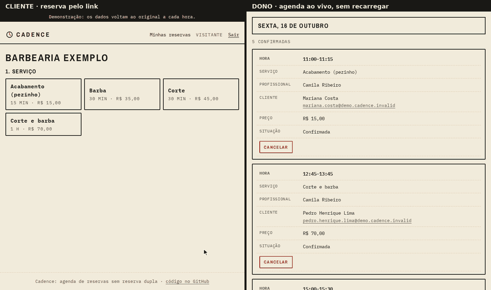
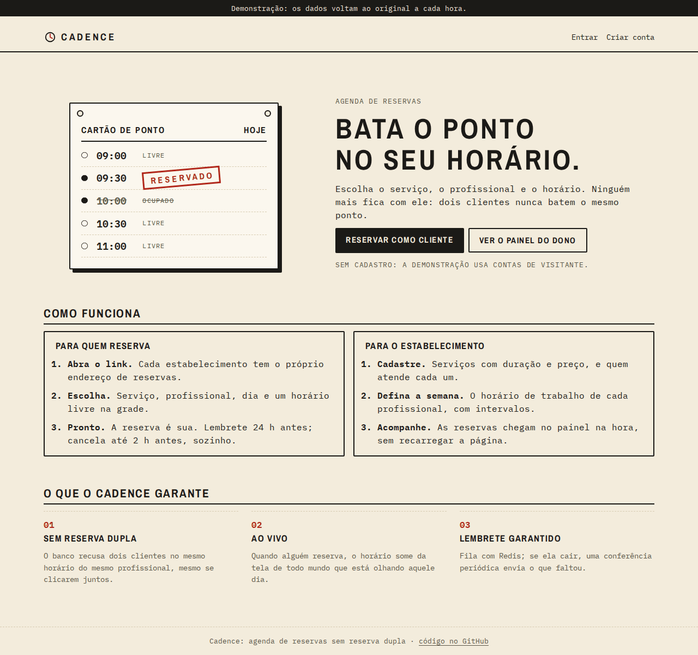
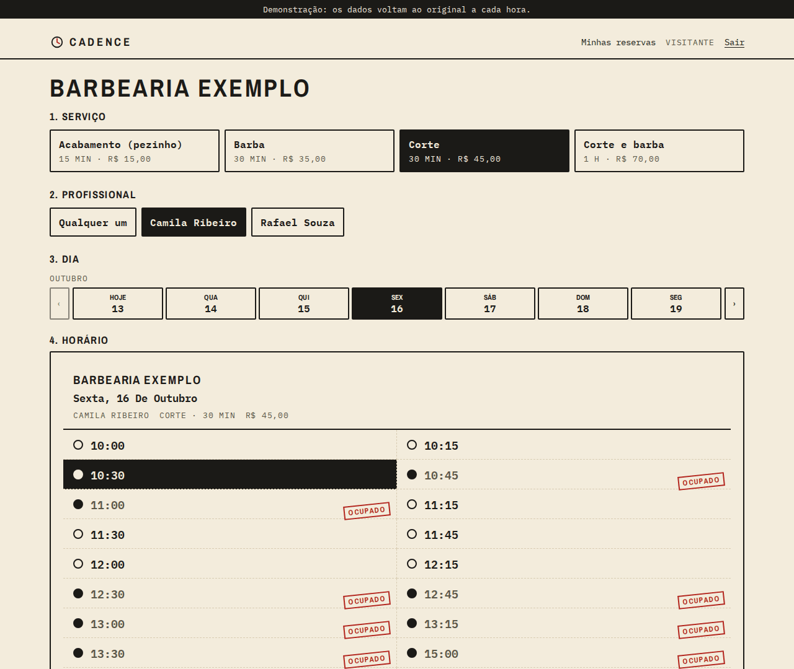
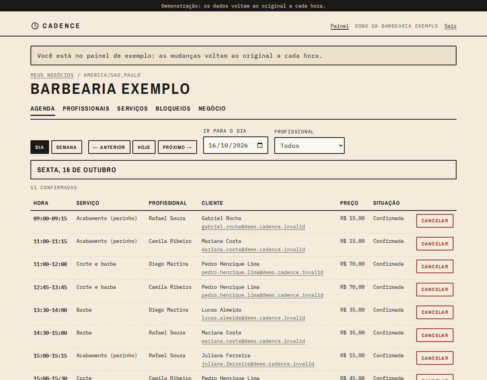
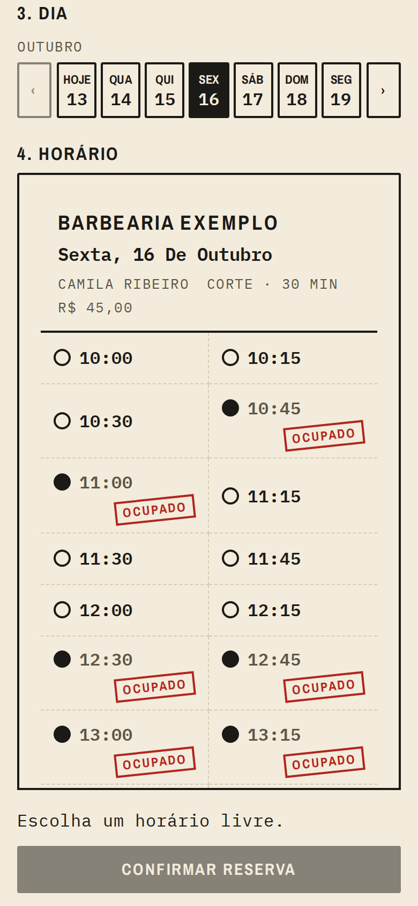

# Cadence

**Cadence · agenda de reservas sem reserva dupla.**

[](https://github.com/Lakes777/cadence/actions/workflows/ci.yml)

Uma API de agendamento para negócios que atendem com hora marcada (barbearia, quadra, estúdio):
o dono cadastra profissionais, serviços e horários; o cliente escolhe um horário livre e reserva.
O ponto central é que **dois clientes nunca ficam com o mesmo horário**, nem clicando no mesmo
milissegundo.

**No ar (demonstração):** https://cadence.andrelagos.dev: entre como cliente ou como
dono da Barbearia Exemplo, sem cadastro; os dados voltam ao original a cada hora.



É o meu primeiro projeto em **NestJS** (TypeScript).

## Fases

- [x] **1. Esqueleto:** NestJS 12 com TypeScript `strict`, configuração validada na partida (zod), PostgreSQL com Prisma, `/saude`, logs estruturados (pino) com id por pedido, testes com Testcontainers, CI com lint
- [x] **2. Contas e papéis:** cadastro e login (senha com scrypt), token de acesso de 15 min + token de renovação rotativo em cookie httpOnly com detecção de reuso, papéis de dono e cliente, limite de tentativas por IP
- [x] **3. Catálogo:** negócio com endereço público, profissionais, serviços (duração e preço), quem faz o quê, horário semanal (o banco recusa intervalos sobrepostos) e bloqueios (folga, feriado); cada dono só enxerga o que é dele
- [x] **4. Disponibilidade:** horários livres do dia por serviço, no fuso do negócio (conversão feita à mão com `Intl`, testada nos dias de horário de verão), com bloqueios, antecedência mínima e janela de 60 dias
- [x] **5. Reservas:** restrição de exclusão no Postgres contra horários sobrepostos, `Idempotency-Key` contra clique duplo, cancelamento com antecedência mínima, agenda do dono e teste com 50 pedidos simultâneos no mesmo horário
- [x] **6. Lembretes:** fila (BullMQ + Redis) com o lembrete agendado para 24 h antes; cancelar tira o lembrete da fila; sem Redis, as reservas seguem e uma conferência periódica envia o que a fila perdeu
- [x] **7. Tempo real:** WebSocket: quem está olhando o dia vê o horário sumir quando outra pessoa reserva, e o cliente recebe as próprias reservas e lembretes na hora, sem recarregar
- [x] **8. Interface:** React + Vite (renovação do token em fila única entre as abas), com identidade visual própria ("Relógio de ponto", ver [docs/identidade.md](docs/identidade.md)); tela do cliente, painel do dono e um negócio de demonstração
- [x] **9. Publicação:** Docker Compose numa VM ARM da Oracle, ao lado do Beacon e do Pursuit (Postgres e Caddy deles, Redis próprio), com HTTPS, a API servindo as telas no mesmo endereço e vigiado pelo [Vigil](https://github.com/Lakes777/vigil); só a demonstração vai ao ar

## Rodando

Precisa de Node 24 e Docker.

```bash
npm ci
npm run gerar               # cliente do Prisma a partir de prisma/schema.prisma
cp .env.exemplo .env
docker compose up -d        # Postgres (porta 5434) e Redis (porta 6380) de desenvolvimento
npm run migrar
npm run start:dev           # http://localhost:3000/saude
```

A interface fica em `web/` (outro terminal). O Vite lê a `PORTA` do `.env` da raiz e repassa
para a API as rotas dela (`/auth`, `/negocios`, `/reservas`, `/avisos`, `/demo`, `/tempo-real`...):

```bash
cd web
npm ci
npm run dev                 # http://localhost:5180
```

Para ver com a Barbearia Exemplo, use um banco só da demonstração (a semeadura recusa um banco
com contas de verdade), com `CADENCE_DEMO=true` e `npm run semear-demo` (ver
[Demonstração](#demonstração)).

## Configuração

Lida do ambiente e validada na partida: se algo estiver errado, a API não sobe e diz o que falta
(sem mostrar os valores).

| Variável | Padrão | Para quê |
|---|---|---|
| `DATABASE_URL` | (obrigatória) | `postgresql://...` |
| `REDIS_URL` | (obrigatória) | `redis://...` ou `rediss://...` (fila de lembretes) |
| `PREFIXO_DA_FILA` | `cadence` | prefixo das chaves no Redis (para dividir um Redis com outras aplicações) |
| `PORTA` | `3000` | porta HTTP |
| `NODE_ENV` | `production` | `development` mostra os logs legíveis (o `.env.exemplo` já vem assim); os outros, em JSON |
| `NIVEL_DO_LOG` | `info` | `fatal` a `trace`, ou `silent` |
| `JWT_SEGREDO` | (obrigatório) | assina os tokens de acesso; pelo menos 32 caracteres (`openssl rand -hex 32`) |
| `PEDIDOS_PUBLICOS_POR_MINUTO` | `120` | pedidos por IP a cada minuto em cada rota pública (vitrine, disponibilidade, reservar); limite separado do de conta |
| `PEDIDOS_DE_CONTA_POR_MINUTO` | `10` | pedidos por IP a cada minuto em **cada** rota de conta (cadastro, entrar, renovar); o excesso leva `429` |
| `CONEXOES_POR_IP` | `20` | conexões de WebSocket abertas ao mesmo tempo por IP (cada aba é uma); o excesso leva `429` |
| `CONEXOES_POR_MINUTO` | `60` | conexões de WebSocket **novas** por IP a cada minuto (pega quem abre e fecha em loop); o excesso leva `429` |
| `CONFIANCA_NO_PROXY` | `loopback` | de quem aceitar o `X-Forwarded-For` (o IP real usado no limite e nos logs): `loopback`, `uniquelocal`, IPs ou sub-redes separados por vírgula. Com o Caddy em container, use a sub-rede do Docker; sem isso, todo mundo divide o mesmo limite |
| `CADENCE_DEMO` | `false` | `true` liga a [demonstração](#demonstração): entrar como visitante, cadastro fechado e `npm run semear-demo` |
| `VISITANTES_POR_HORA` | `300` | só na demonstração: contas de visitante cliente criadas por hora, somando todos os IPs |
| `PASTA_DAS_TELAS` | (vazia) | pasta do build das telas (`web/dist`); com ela, a API serve as telas no mesmo endereço (a imagem Docker já vem com `/app/telas`). Vazia, só a API: no desenvolvimento quem serve as telas é o Vite |

## Contas

| Rota | O que faz |
|---|---|
| `POST /auth/cadastro` | `{nome, email, senha, papel?}` (papel `cliente` por padrão, ou `dono`) → `201` |
| `POST /auth/entrar` | `{email, senha}` → `200`; senha errada e e-mail sem conta dão a mesma resposta `401`, no mesmo tempo |
| `POST /auth/renovar` | usa o cookie → `200` com token de acesso novo e cookie novo |
| `POST /auth/sair` | encerra a sessão deste aparelho e apaga o cookie → `204` |
| `GET /auth/eu` | o usuário do token |

Cadastro, login e renovação respondem `{usuario, tokenDeAcesso, expiraEm}`. O token de acesso
(JWT HS256, 15 min) vai no cabeçalho `Authorization: Bearer ...` e a interface o guarda só na
memória. O **token de renovação** nunca aparece no corpo: vai num cookie `httpOnly`,
`SameSite=Strict`, restrito a `/auth` e `Secure` em produção, e o banco guarda só o SHA-256 dele.

**Rotação com detecção de reuso:** cada renovação gasta o token e entrega o próximo da mesma
"família" (uma família por login). Se um token já gasto aparece de novo, alguém tem uma cópia
dele, e a família inteira é revogada: o ladrão perde o acesso e o dono de verdade entra de novo
com a senha. Duas exceções de bom senso:

- O mesmo token de novo **em até 30 s** é o próprio navegador (duas abas abrindo juntas, ou uma
  resposta que se perdeu na rede): em vez de derrubar a sessão, o token emitido antes é revogado
  e sai um novo no lugar. A regra é **um único token válido por família**; quem aparecer depois
  com um token revogado de uma família ainda viva também conta como roubo. A linha do token é
  trancada (`SELECT ... FOR UPDATE`), então pedidos simultâneos entram em fila (o teste dispara 5
  ao mesmo tempo e confere que só um token sobra valendo). Troca consciente: se as respostas de
  duas abas chegarem fora de ordem, o navegador fica com o token revogado e a pessoa entra de
  novo; a interface (fase 8) evita isso fazendo as abas renovarem uma de cada vez
  (`navigator.locks`).
- Cada renovação empurra o prazo para 30 dias, mas uma família **vive no máximo 90 dias**: um
  token roubado não vale para sempre.

**CSRF:** além do `SameSite=Strict`, os `POST` de `/auth` exigem `Content-Type: application/json`
(`415` sem ele). Um formulário de outro site não consegue mandar esse cabeçalho, e um `fetch` de
outra origem com ele precisa de CORS, que a API não libera.

**Escolha consciente:** o login não revela quais e-mails têm conta, mas o cadastro responde `409`
para e-mail repetido (para a pessoa saber que deve entrar em vez de se cadastrar). O limite de
pedidos por IP deixa uma varredura lenta.

Toda rota exige login, a não ser as marcadas com `@Publica()` (o guard é global, então esquecer o
decorador fecha a rota em vez de abri-la). `@Papeis('dono')` limita a rota a um papel (`403`
para os outros). Qualquer pessoa pode se cadastrar como dono (é assim que um negócio novo entra),
então **o papel não basta**: a partir da fase 3, toda ação de dono confere também que o negócio é
dele.

## Catálogo

Rotas do dono (token de dono; `403` para cliente). Tudo que vem depois de `/negocios/:id` confere
que o negócio é de quem pede: o de outro dono responde `404`, igual a um id que não existe, para
não confirmar que ele existe. Profissional, serviço e bloqueio também precisam ser **daquele**
negócio (trocar só o id na URL não alcança os dados de outro dono; há teste para cada caso).

| Rota | O que faz |
|---|---|
| `POST /negocios` | `{nome, slug?, fuso?}`; sem `slug`, ele sai do nome ("Barbearia São João" → `barbearia-sao-joao`, com sufixo se já existir); fuso padrão `America/Sao_Paulo` |
| `GET /negocios` | os negócios de quem está logado |
| `PATCH /negocios/:id` | muda nome, endereço ou fuso |
| `GET/POST /negocios/:id/profissionais` | lista (com serviços e horários) e cria |
| `PATCH /negocios/:id/profissionais/:pid` | muda o nome ou desativa (`{"ativo": false}`); não há apagar, por causa das reservas |
| `PUT /negocios/:id/profissionais/:pid/servicos` | `{servicoIds: [...]}`: troca a lista do que ele faz |
| `PUT /negocios/:id/profissionais/:pid/horarios` | `{horarios: [{diaDaSemana, inicio: "09:00", fim: "12:00"}]}`: troca a semana inteira |
| `GET/POST /negocios/:id/servicos`, `PATCH .../:sid` | duração de 5 a 480 min (múltipla de 5), preço em centavos |
| `GET/POST /negocios/:id/bloqueios`, `DELETE .../:bid` | `{profissionalId?, inicio, fim, motivo?}`; sem profissional, vale para o negócio todo; `GET` aceita `?de=&ate=` (no máximo 1 ano por consulta e 500 bloqueios; sem nada, o próximo ano; só com um dos dois, o ano a partir de `de` ou até `ate`) |

E a vitrine pública, sem login: `GET /negocios/:slug` devolve o nome, o fuso, os profissionais
ativos e os serviços ativos que algum profissional ativo faz (com quem faz cada um). Nada do dono
aparece.

**Horas:** o horário semanal é hora local do negócio (o fuso dele, gravado com o nome canônico
IANA), guardado como minutos desde a meia-noite; `24:00` fecha o dia. Trocar o fuso do negócio
muda o sentido de todos os horários ("09:00" passa a ser 09:00 do fuso novo); a partir da fase 5,
com reservas marcadas, essa troca vai precisar de cuidado. Bloqueios são instantes absolutos: a API exige data e hora com
fuso (`2026-12-25T00:00:00-03:00`) e guarda em UTC. Fica para a fase 4 juntar os dois no cálculo
dos horários livres.

**No banco:** além das validações da API, o Postgres tem as próprias regras (`CHECK` para
duração, preço, formato do endereço, dia e intervalo) e uma restrição de exclusão
(`EXCLUDE USING gist`, extensão `btree_gist`) que não deixa dois intervalos do mesmo profissional
se sobreporem no mesmo dia. As ligações também não misturam negócios no banco: a tabela de "quem
faz o quê" tem chaves estrangeiras compostas com o `negocio_id`, e um gatilho confere que o
profissional de um bloqueio é do mesmo negócio. Duas trocas de horário ao mesmo tempo entram em fila
(`SELECT ... FOR UPDATE` no profissional); o teste dispara 6 juntas.

## Disponibilidade

`GET /negocios/:slug/disponibilidade?servicoId=...&data=2026-10-12[&profissionalId=...]`, sem
login, devolve os horários livres daquele dia para o serviço e os que já foram reservados:

```json
{
  "data": "2026-10-12",
  "fuso": "America/Sao_Paulo",
  "servico": { "id": "...", "nome": "Corte", "duracaoMin": 30 },
  "horarios": [
    { "inicio": "2026-10-12T12:00:00.000Z", "fim": "2026-10-12T12:30:00.000Z",
      "hora": "09:00", "profissionalIds": ["..."] }
  ],
  "ocupados": [
    { "inicio": "2026-10-12T12:30:00.000Z", "fim": "2026-10-12T13:00:00.000Z", "hora": "09:30" }
  ]
}
```

- Os horários começam a cada 15 min dentro do expediente de cada profissional ativo que faz o
  serviço, e só entram se o atendimento inteiro couber no expediente e não encostar em nenhum
  bloqueio (dele ou do negócio todo). Quem pode atender no mesmo horário aparece junto.
- Nada começa em menos de **30 min** a partir de agora; a agenda abre **60 dias** à frente
  (`400` depois disso); dia que já passou volta vazio.
- `data` é o dia no **fuso do negócio**; `inicio` e `fim` saem em UTC e `hora` no relógio local.
- `ocupados` são os horários que seriam oferecidos se não houvesse reservas e que agora ninguém
  pode atender (a tela os mostra com o carimbo "OCUPADO"). Sem `profissionalId`, um horário só
  conta como ocupado se nenhum profissional puder atender; com ele, vale a agenda daquele
  profissional. Bloqueio não vira ocupado (o horário só deixa de aparecer), e o ocupado não diz
  quem reservou nem com qual profissional.

O cálculo é uma função pura (`src/disponibilidade/calculo.ts`): recebe o dia, o fuso, a duração,
os expedientes, os bloqueios, as reservas (a partir da fase 5) e "agora", e devolve os horários
(`calcularDia` faz a mesma conta sem as reservas para achar os ocupados).
Por isso é testada sem banco e sem relógio. O relógio da API é injetado (`RELOGIO`), e os testes
de ponta a ponta o param numa segunda-feira conhecida.

**Fuso sem biblioteca:** a conversão de "09:00 de tal dia em tal fuso" para UTC usa só `Intl`
(`src/disponibilidade/fuso.ts`). Os testes cobrem os dois dias difíceis do horário de verão
(Lisboa e Nova York nos dois sentidos, Santiago com a meia-noite que não existe): quando o relógio pula, a hora que não existe não é oferecida; quando
volta, a hora repetida é oferecida uma vez só, e a duração é sempre a real (30 min são 30 min,
mesmo atravessando a mudança). Se o fim do expediente cair na hora que não existe, ele acaba no
pulo do relógio. As rotas públicas têm limite de pedidos por IP (`PEDIDOS_PUBLICOS_POR_MINUTO`).

## Reservas

| Rota | Quem | O que faz |
|---|---|---|
| `POST /negocios/:slug/reservas` | qualquer pessoa logada | `{servicoId, profissionalId?, inicio}` com o cabeçalho `Idempotency-Key` → `201` |
| `GET /reservas` | quem reservou | as próprias reservas; `?periodo=proximas` (padrão) ou `anteriores` |
| `POST /reservas/:id/cancelar` | quem reservou ou o dono | cancela → `200` |
| `GET /negocios/:id/agenda` | dono | as reservas do negócio com o nome e o e-mail de quem reservou; `?de=&ate=` (até 1 ano) |

**Sem reserva dupla, em duas camadas.** A API só aceita um `inicio` que a disponibilidade
ofereceria naquele momento (mesmo cálculo da fase 4, agora descontando as reservas). Mas entre
conferir e gravar há uma janela, e dois pedidos podem passar juntos pela conferência. Quem fecha
essa janela é o Postgres:

```sql
ALTER TABLE reservas ADD CONSTRAINT reservas_sem_sobreposicao
    EXCLUDE USING gist (profissional_id WITH =, tstzrange(inicio, fim, '[)') WITH &&)
    WHERE (status = 'confirmada');
```

Duas reservas confirmadas do mesmo profissional não podem se sobrepor (encostar pode: `[)`),
seja qual for o serviço. Quem chega depois recebe o erro `23P01` e a API responde `409`. Sem
profissional escolhido, a API tenta o próximo que estava livre. Reserva cancelada não ocupa.
O teste dispara **50 clientes no mesmo horário ao mesmo tempo** e confere que exatamente um
consegue (e que o banco tem uma reserva só); com duas profissionais livres, exatamente dois
conseguem, um com cada.

**Clique duplo (`Idempotency-Key`).** Toda reserva exige o cabeçalho (a interface gera um UUID
por tentativa). O mesmo cliente repetindo a mesma chave com o mesmo pedido recebe a **mesma**
reserva com `200`, em vez de criar outra; a mesma chave com outro pedido é `422`. A chave fica
gravada na reserva (única por cliente). O teste manda 10 cópias simultâneas e confere que sai uma
reserva só. Foi esse teste que mostrou que a cópia atrasada pode esbarrar primeiro na própria
reserva que a outra acabou de criar (não na chave), por isso todo conflito confere a chave antes
de responder `409`.

**Cancelamento:** o cliente cancela até **2 h antes**; depois disso só o dono, e ninguém depois
que o atendimento começou (`422`). Quem não é o cliente nem o dono recebe `404`. Cancelar de novo
devolve a reserva como está. O preço fica gravado na reserva no momento em que ela é feita.

**Escolhas conscientes:**
- A restrição vale **por profissional**: o mesmo cliente pode ter duas reservas no mesmo horário
  com profissionais diferentes (pai e filho cortando o cabelo juntos). O clique duplo é coberto
  pela `Idempotency-Key`, que a interface gera uma vez por tentativa, não por clique.
- Um bloqueio criado depois **não cancela** reservas já marcadas naquele período: o dono vê as
  duas coisas na agenda e decide o que fazer com cada cliente.
- `GET /reservas` traz as 100 próximas (ou as 100 últimas); a agenda do dono responde `400`
  pedindo um período menor se houver mais de 1000 reservas, em vez de cortar a lista calada.

**Privacidade:** a disponibilidade pública só diz que o horário não está livre, nunca quem
reservou; só o dono vê os clientes, e só os do próprio negócio.

## Lembretes

Cada reserva feita com mais de 24 h de antecedência ganha um **lembrete para 24 h antes**, numa
fila do BullMQ no Redis (tarefa atrasada até a hora certa). Na hora, o trabalhador grava um aviso
para o cliente, que aparece em `GET /avisos`. O mesmo aviso chega na hora pelo WebSocket
(ver [Tempo real](#tempo-real)). Quem reserva em cima da hora (menos de 24 h antes) acabou de ver a reserva e
não recebe lembrete.

| Rota | O que faz |
|---|---|
| `GET /avisos` | os 50 avisos mais recentes de quem está logado; `reservaCancelada` avisa quando a reserva foi cancelada depois do lembrete |
| `POST /avisos/:id/lido` | marca como lido → `200`; aviso de outra pessoa é `404` |

**O que pode dar errado, e o que acontece:**

- **Clique em cancelar:** o id da tarefa é o id da reserva, então cancelar sabe qual tirar da
  fila. Se a tarefa já estiver saindo, o envio confere o status e desiste.
- **Cancelamento e envio no mesmo instante:** o envio trava a reserva (`SELECT ... FOR SHARE`)
  antes de conferir o status. Um cancelamento em andamento faz o envio esperar e desistir, nunca
  um lembrete de reserva já cancelada. Há um teste que segura o cancelamento aberto e confere que
  o envio espera; sem a trava, ele falha.
- **A fila entrega pelo menos uma vez** (uma tarefa pode rodar de novo depois de uma falha): o
  banco tem chave única `(reserva, tipo)` no aviso, e repetir não gera um segundo. O teste manda 10
  envios juntos e sai um aviso.
- **Redis fora do ar:** a reserva **não depende dele**. O comando falha na hora (sem fila de espera
  local no cliente do Redis), a reserva sai normalmente e o momento do lembrete fica gravado na
  própria reserva (`lembrete_em`). Uma **conferência** roda na partida e a cada 5 min, procura
  reservas cujo lembrete venceu há mais de 2 min sem aviso e envia direto pelo banco, enquanto o
  atendimento não começou. Há teste com o Redis desligado, e o log registra só a queda e a volta,
  não cada tentativa de reconectar (uma linha por conexão: a da fila e a do trabalhador). Há
  teste também com o Redis congelado e a conexão ainda aberta (`CLIENT PAUSE`): a reserva
  desiste do Redis em 2 s e sai.
- **Banco fora do ar na hora do envio:** a tarefa tenta 5 vezes no total (a primeira e mais 4,
  após 10 s, 20 s, 40 s e 80 s); se todas falharem, a conferência pega depois. Na conferência, um
  envio que falha não segura os outros do lote.

No `compose.yaml`, o Redis grava em disco (`appendonly`) e nunca descarta chaves por falta de
memória (`noeviction`, exigido pelo BullMQ). O trabalhador roda no mesmo processo da API, porque é
pouco trabalho; para separar, bastaria subir o provedor dele em outro processo.

**Escolha consciente:** por enquanto, o lembrete fica **dentro do sistema** (`/avisos`), sem
e-mail. Mandar e-mail precisaria de um serviço de envio e de um domínio verificado. Com o aviso
gravado no banco, esse canal vira mais um passo depois da gravação.

## Tempo real

WebSocket em `/tempo-real` (`wss://` atrás do Caddy). Quem está olhando os horários de um dia vê
o horário sumir quando outra pessoa reserva, sem a tela ficar perguntando a cada segundo. O
servidor não manda a lista nova: avisa **quais dias mudaram**, e a tela busca de novo em
`/disponibilidade`. Assim a regra do cálculo continua num lugar só.

O navegador manda JSON:

| Mensagem | O que faz |
|---|---|
| `{"tipo":"assinar","negocio":"<slug>"}` | passa a receber `horarios` e `catalogo` desse negócio (sem login; até 10 negócios por conexão) |
| `{"tipo":"desassinar","negocio":"<slug>"}` | para de receber |
| `{"tipo":"entrar","token":"<token de acesso>"}` | liga a conexão à conta: chegam as próprias `reserva` e `aviso` |
| `{"tipo":"sair"}` | desliga da conta (a conexão continua) |

O servidor manda:

| Mensagem | Quando |
|---|---|
| `horarios` `{negocio, de, ate}` | uma reserva, um cancelamento ou um bloqueio mudou os dias de `de` a `ate` (datas no fuso do negócio) |
| `catalogo` `{negocio}` | o dono mudou o horário semanal, um profissional (ativo, serviços), um serviço (duração, ativo) ou o negócio (fuso, endereço): qualquer dia pode ter mudado, busque de novo o que está na tela. Se o endereço mudou, vem `novoEndereco` (o antigo passa a dar `404`) |
| `reserva` `{reserva}` | uma reserva sua foi criada (em outra aba) ou cancelada (por você ou pelo estabelecimento) |
| `aviso` `{aviso}` | o lembrete de 24 h antes, no momento em que é gravado (o mesmo de `GET /avisos`) |
| `sessaoVencida` | o token venceu: mande `entrar` com um novo para voltar a receber |
| `entrou` `{expiraEm}`, `saiu` | confirmam `entrar` (segundos até o token vencer) e `sair` |
| `assinado` `{negocio}`, `desassinado` `{negocio}` | confirmam `assinar` e `desassinar` |
| `erro` `{mensagem}` | mensagem que não é JSON, tipo desconhecido, slug inválido, token inválido |

**Escolhas e o que pode dar errado:**

- **O token vai numa mensagem, não na URL:** a URL fica gravada no log do proxy. A conexão fica
  ligada à conta só até o token vencer (15 min), como no resto da API. A interface manda `entrar`
  de novo a cada renovação. Se a aba manda `entrar` e logo depois `sair` (ou `entrar` com outra
  conta), vale a última mensagem mandada, mesmo que a conferência do primeiro token termine depois.
- **Privacidade:** `horarios` diz só que um dia mudou, nunca quem reservou. `reserva` e `aviso`
  vão apenas para as conexões da própria pessoa.
- **O aviso sai depois de gravado.** A reserva já está no banco quando `horarios` chega, então a
  busca seguinte já não mostra o horário. Uma falha ao avisar fica no log e nunca transforma a
  operação já gravada num erro (a reserva feita não vira `500`; o lembrete não roda de novo, porque
  o aviso já está em `GET /avisos`).
- **Limites:** `CONEXOES_POR_IP` abertas por IP e `CONEXOES_POR_MINUTO` novas por IP a cada
  minuto (o excesso leva `429` antes de abrir; o IP é o mesmo do Express, respeitando
  `CONFIANCA_NO_PROXY`), mensagens de até 4 KB (`1009`), até 30
  mensagens a cada 10 s (`1008`), e quem não lê o que chega (mais de 1 MB parado) é derrubado.
  Um erro inesperado ao tratar uma mensagem derruba só aquela conexão. Quem pede o upgrade e
  corta a conexão (RST) antes de o WebSocket abrir também não derruba o processo: há teste para
  isso, porque sem o tratamento a API caía. O limite por minuto existe porque o de abertas não pega quem
  abre e fecha em loop, e cada abertura custa um upgrade; conta só as aceitas, numa janela fixa
  de 60 s, e o navegador reconecta com espera crescente (1 s a 30 s), então uma aba faz poucas por
  minuto. Os limites contam cada IPv6 inteiro (quem tem um bloco `/64` escaparia deles), mas a VM
  de publicação só tem IPv4.
- **Conexões mortas:** um ping a cada 30 s derruba quem não respondeu ao anterior (Wi-Fi caído,
  celular dormindo).
- **Ao desligar** (deploy, `docker stop`), cada conexão recebe `1001` e o servidor espera no
  máximo 1 s pela resposta antes de derrubar. Detalhe que um teste pegou: no NestJS 12, o
  servidor HTTP fecha **antes** do `onApplicationShutdown`, e ele espera as conexões de
  WebSocket terminarem. Fechá-las ali deixava os dois esperando um pelo outro. Por isso o
  fechamento fica no `beforeApplicationShutdown`.
- **Uma instância só:** quem está conectado fica na memória do processo. Com duas instâncias da
  API, os eventos precisariam passar por um canal comum (por exemplo, o pub/sub do Redis que a
  fila já usa).

## Interface

React 19 + Vite + react-router, em `web/`, com a identidade "Relógio de ponto"
([docs/identidade.md](docs/identidade.md)): papel creme, tinta preta, números em fonte de
máquina e um carimbo vermelho só para o que está ocupado. As rotas das telas (`/`, `/b/<endereço>`,
`/minhas`, `/painel`, `/entrar`, `/cadastro`) não usam nenhum prefixo da API, então o mesmo
endereço serve as duas coisas no deploy (o cookie de renovação é `SameSite=Strict` e só vai para
a mesma origem).

**Tela do cliente.** A página de início abre com um cartão de ponto animado (as linhas passam pela
máquina e o carimbo RESERVADO cai num horário), explica como funciona para quem reserva e para o
estabelecimento e o que o sistema garante. Na demonstração, oferece os dois caminhos: reservar no
negócio de exemplo ou abrir o painel do dono direto como visitante; fora dela, leva à agenda pelo
endereço que cada estabelecimento divulga. Em `/b/<endereço>`, o cliente escolhe o serviço, o profissional (ou
"qualquer um") e o dia, sempre no fuso do negócio, e vê o dia como um cartão de ponto: cada
horário tem um furo, vazio quando está livre e cheio com o carimbo "OCUPADO" quando já foi
reservado, sem nunca dizer por quem. Serviço, profissional e dia ficam na URL, então voltar do
login (ou recarregar) devolve a pessoa ao mesmo horário. A reserva vai com uma `Idempotency-Key`
por tentativa: repetir o mesmo envio depois de uma queda de rede não cria uma segunda reserva.
Pelo WebSocket, o horário que outra pessoa pega some na hora com um contorno vermelho, e quem
estava com ele escolhido é avisado ("Alguém reservou 09:30 antes de você"); se o estabelecimento
muda de endereço, a tela segue para o novo. Em "Minhas reservas", o cliente vê as próximas e as
anteriores, cancela (com a regra das 2 h explicada pelo servidor) e recebe os lembretes e as
mudanças das próprias reservas sem recarregar.

**Painel do dono (`/painel`).** Lista os negócios da conta e cria um novo (nome, endereço e fuso).
Em cada negócio, a **agenda** mostra as reservas do dia ou da semana no relógio do negócio, mesmo
que o navegador esteja em outro fuso, com quem reservou (nome e e-mail, que só o dono vê), preço e
situação; dá para filtrar por profissional e cancelar com confirmação. Ela é **ao vivo**: quando
alguém reserva ou cancela, a lista é buscada de novo sem piscar, a reserva nova fica destacada por
um instante e o leitor de tela anuncia "Nova reserva às HH:MM". Em **Profissionais**, o dono
cadastra quem atende, marca os serviços de cada um e monta o horário semanal (vários intervalos
por dia, com "copiar para os dias úteis"); se dois intervalos se sobrepõem, o erro aparece no
intervalo certo. Em **Serviços**, cadastra duração e preço (digitado em reais, gravado em centavos
sem erro de arredondamento). Em **Bloqueios**, marca folgas e feriados com data e hora no fuso do
negócio; a conversão para UTC é feita só com `Intl`, testada nos dias de horário de verão (a hora
que não existe é recusada antes de mandar). Em **Negócio**, edita nome, endereço e fuso e copia o
link público `/b/<endereço>` para divulgar.

**Sessão entre abas.** O token de acesso fica só na memória da aba (nunca no `localStorage`, onde
um script injetado o leria); quem mantém a pessoa logada é o cookie `httpOnly`. Renovar gasta o
token de renovação, então duas abas renovando juntas poderiam deixar uma com o token já gasto:
a renovação passa por uma trava do navegador compartilhada entre as abas (`navigator.locks`), uma
de cada vez. Entrar ou sair numa aba avisa as outras (`BroadcastChannel`), e as telas montam de
novo quando a conta muda, para não sobrar na tela o que era da conta anterior. Só `401`/`403`
encerram a sessão: uma renovação que cai num `502` do deploy ou sem rede tenta de novo em 30 s.

**Tempo real na tela.** Uma conexão por aba. Se ela cair, volta sozinha (espera crescente, com
sorteio para as abas não voltarem juntas), refaz as assinaturas, entra de novo com o token do
momento e avisa as telas para buscarem de novo o que pode ter mudado enquanto estava fora.

**Acessibilidade.** Rótulo em todo campo (o erro do servidor vai embaixo e é lido uma vez), foco
visível, "pular para o conteúdo", título da aba por página, horários lidos como "09:30, livre" e
navegáveis pelas setas, avisos ao vivo em `aria-live`, confirmações que levam o foco para a saída
segura (Esc volta) e o foco devolvido ao cartão ou à linha depois de cancelar ou reservar. Animações
desligam com `prefers-reduced-motion`. Funciona a partir de 360 px (as tabelas do painel viram
cartões empilhados).

| Início | Reservar |
|---|---|
|  |  |
| **Painel do dono** | **No celular** |
|  |  |

## Demonstração

Com `CADENCE_DEMO=true`, a API vira uma vitrine para quem quer experimentar sem criar conta: a
**Barbearia Exemplo** (`/negocios/barbearia-exemplo`), com três profissionais, quatro serviços, um
bloqueio e a agenda da semana já parcialmente ocupada por clientes fictícios. Quem visita entra
como cliente (e reserva) ou como dono (e mexe no painel) com um clique.

| Rota | O que faz |
|---|---|
| `GET /demo` | `{"demo": true, "negocio": "barbearia-exemplo"}` com a demonstração ligada; `{"demo": false, "negocio": null}` desligada (a interface decide se mostra os botões de visitante) |
| `POST /auth/visitante` | `{"papel": "cliente" \| "dono"}` → `200` com a mesma resposta e o mesmo cookie de `/auth/entrar` (renovar e sair funcionam igual); `404` com a demonstração desligada |

- **Cliente:** cada clique cria uma conta nova ("Visitante", `visitante-<uuid>@demo.cadence.invalid`).
  Assim cada visitante vê só as próprias reservas, e ninguém cancela a reserva de outro.
- **Dono:** todos entram na mesma conta, a do dono da Barbearia Exemplo. Pode mexer em quase tudo
  (profissionais, serviços, horários, bloqueios, cancelar reservas), menos o **nome, o endereço
  e o fuso** da barbearia (`403`; mandar o mesmo valor passa): trocar o endereço tiraria a
  vitrine do ar para os outros visitantes, o fuso mudaria todos os horários e o nome aparece
  para todos, até a próxima reposição. Também não cria **negócio novo** (`403`): ele ganharia
  uma página pública com o nome e o endereço que o visitante quisesse. Nomes de profissionais e
  serviços continuam editáveis (o painel precisa disso); o estrago dura no máximo uma hora.
- Antes da primeira semeadura, entrar como dono responde `503` (e também se o dono da
  `barbearia-exemplo` não for uma conta da demonstração: nunca entregar a conta de alguém).

**Limites contra abuso** (um script poderia encher a agenda ou o banco entre uma reposição e
outra):

- Cada visitante tem até **3 reservas futuras** (`422` depois disso; cancelar libera). Dois
  pedidos no mesmo instante podem passar um a mais; o teto continua pequeno.
- No máximo `VISITANTES_POR_HORA` (padrão 300) contas de visitante cliente por hora, **somando
  todos os IPs** (`503` "a demonstração está cheia"): o limite por IP não segura quem troca de
  IP. Entrar como dono não cria conta e não conta.

**Contas da demonstração:** todas usam e-mails em `@demo.cadence.invalid` (o `.invalid` é reservado
e nunca existe de verdade) e uma senha que nenhuma senha confere: só entram por
`/auth/visitante`. O cadastro recusa esse domínio sempre, com ou sem demonstração.

**Por que o cadastro fecha (`403`, "Na demonstração, entre como visitante."):** o dono visitante
é compartilhado, e a agenda mostra o nome e o e-mail de quem reservou. Quem se cadastrasse com
os dados de verdade os deixaria à vista de qualquer outro visitante. `/auth/entrar` com senha
continua funcionando.

**Reposição (`npm run semear-demo`).** Roda contra o build, sem subir a API (na VM:
`docker compose exec -T api npm run semear-demo`), numa transação só (quem estiver olhando vê a
barbearia antiga ou a nova, nunca pela metade; duas reposições ao mesmo tempo entram em fila):

1. Apaga as contas de cliente da demonstração (visitantes e fictícias), com as reservas, os
   avisos e os tokens de renovação delas, e os negócios do dono (a barbearia e qualquer outro
   que um visitante tenha criado).
2. Recria a Barbearia Exemplo do zero (fuso `America/Sao_Paulo`): Rafael, Camila e Diego,
   Corte (30 min, R$ 45), Barba (30 min, R$ 35), Corte e barba (60 min, R$ 70) e Acabamento
   (15 min, R$ 15), horário de segunda a sábado com almoço, e uma consulta médica do Diego
   daqui a 3 dias à tarde.
3. Cria reservas de oito clientes fictícios nos próximos 7 dias a partir de agora, dentro do
   expediente, fora do bloqueio e sem sobrepor (a restrição de exclusão recusaria). Cada
   horário é escolhido por um hash da data e da hora, não por sorteio: rodar duas vezes seguidas
   dá o mesmo estado (há teste), e com o tempo só somem as que já começaram.

**Proteção:** a semeadura apaga dados, então recusa (sai com `1` e diz por quê) se
`CADENCE_DEMO` não for `true` **e** se o banco tiver qualquer conta fora de
`@demo.cadence.invalid`. Ligar a variável por engano num banco de verdade não apaga nada.
A **API também não sobe** com `CADENCE_DEMO=true` num banco com contas de verdade (a partida
falha e diz por quê): o cadastro fecharia e qualquer um viraria visitante nos negócios reais.

Uma reserva sendo gravada no instante da reposição não a quebra: o `DELETE` do negócio espera
a reserva terminar e a leva junto na cascata (há teste que segura a reserva aberta no meio da
reposição).

**O que acontece com quem está dentro na hora da reposição:**

- **Todo mundo entra de novo.** As contas de cliente somem (com os tokens), e os tokens de
  renovação do dono são apagados. A conta do dono continua a mesma (mesmo id), então o token de
  acesso de quem está no painel segue valendo até vencer (no máximo 15 min), já apontando para
  a barbearia nova. O id da barbearia muda: a interface busca `GET /negocios` de novo se um id
  antigo responder `404`.
- Um visitante cliente apagado que tenta reservar com o token antigo recebe `401` ("entre de
  novo"), não `500`: quando a reserva esbarra numa chave estrangeira, ela confere se a conta
  ainda existe (outra chave quebrada continua sendo erro).
- **Lembretes na fila:** a reposição não mexe no Redis, e não precisa. A tarefa tem o id da
  reserva, e o envio procura a reserva no banco antes de gravar o aviso: reserva apagada é
  `dispensado`. As tarefas órfãs saem da fila na hora delas (no máximo 7 dias). As reservas de
  exemplo nascem sem lembrete (`lembrete_em` vazio): ninguém lê os avisos das contas fictícias.
- A semeadura roda em outro processo, então não avisa pelo WebSocket: quem está com a página
  aberta vê a barbearia nova ao recarregar (ou na próxima busca).

Na VM, a reposição roda de hora em hora pelo cron (`~/repor-demos.sh`, junto com as demonstrações
do Beacon e do Pursuit), com `node dist/demo/semear.js` dentro do contêiner.

## Publicação

Roda numa VM ARM grátis da Oracle Cloud (1 núcleo Ampere, 6 GB), a mesma do
[Beacon](https://github.com/Lakes777/beacon) e do [Pursuit](https://github.com/Lakes777/pursuit). **Só a
demonstração vai ao ar** (`CADENCE_DEMO=true`): uma instância com cadastro aberto ficaria vazia; se um
dia precisar, é a mesma imagem com outro `.env`.

| Peça | Como |
|---|---|
| Imagem | Três etapas (`Dockerfile`): compila a API e as telas, separa as dependências de produção e leva tudo para um `node:24-alpine` sem root (~160 MB). **Montada no PC x86 para ARM sem emulação**: as duas primeiras etapas rodam na arquitetura do PC, porque o resultado é JavaScript; o único binário nativo (o `msgpackr` do BullMQ) vem com `npm ci --cpu=arm64 --libc=musl` |
| Um endereço só | A API serve o build das telas (`PASTA_DAS_TELAS`): `/assets` com cache eterno (os nomes têm hash), o `index.html` sem cache e para qualquer rota de navegador fora da API; quem não pede HTML recebe o `404` em JSON |
| Banco | No Postgres 17 do Beacon, com banco e usuário `cadence_demo` próprios (`revoke connect ... from public`). Os testes de ponta a ponta rodam no Postgres 17, o mesmo da VM |
| Migrações | Rodam do PC, pelo Prisma do projeto, num **túnel SSH** até o Postgres do Beacon (o `publicar.sh` abre e fecha): a imagem não precisa do Prisma CLI nem do motor nativo dele. Se falharem, nada é publicado |
| Fila | **Redis próprio**, só na rede do Cadence: o do Beacon é cache (`allkeys-lru`, sem disco) e apagaria lembretes agendados; o BullMQ exige `noeviction`. Este tem `appendonly` e volume |
| HTTPS | O Caddy do Beacon importa `~/beacon/sites/*.caddy`; o `publicar.sh` põe lá o `cadence.caddy` (HSTS, `nosniff` e uma CSP só com o próprio endereço, `wss://` incluído) e recarrega o Caddy. O WebSocket passa sem configuração extra |
| IP real | `CONFIANCA_NO_PROXY` = a rede interna do Beacon (`172.30.0.0/24`): só dela o `X-Forwarded-For` vale para os limites |
| Memória | API limitada a 256 MB (`--max-old-space-size=160`), Redis a 64 MB; medido: ~82 MB e ~7 MB |
| Saúde | Healthcheck do Docker com o `fetch` do próprio Node em `/saude` (banco e fila) e o Vigil confere a cada 5 min |
| Demonstração | Reposta de hora em hora pelo cron da VM e a cada publicação. Sem backup: os dados são de exemplo e se refazem sozinhos |

```bash
deploy/preparar-vm.sh    # uma vez: banco, usuário, .env (senhas geradas na VM) e a linha no cron das demos
deploy/publicar.sh       # imagem ARM (exige git limpo; leva o commit), migrações, envio pela SSH, reinício
```

## Saúde

`GET /saude` responde `200 {"status":"ok","banco":"ok","fila":"ok"}` quando o Postgres responde e
`503` quando não: em até 5 s, mesmo com o banco congelado (a consulta tem limite de tempo). O Redis
aparece em `fila` (`ok` ou `fora do ar`), mas não muda o status: sem ele a API continua
funcionando, e reiniciar a API não traria o Redis de volta. A resposta não expõe
o erro do banco; o motivo vai para o log do servidor. O `/saude` não entra no log de pedidos,
porque o Vigil chama a cada minuto.

Todo pedido ganha um `X-Request-Id` na resposta e nos logs; se quem chamou já mandou um válido
(até 64 letras, números, `_` ou `-`), ele é mantido, para seguir o mesmo pedido pelo proxy e pela API.

## Testes

```bash
npm test            # unidade (sem banco)
npm run test:e2e    # ponta a ponta: o Testcontainers sobe um Postgres 17 (o mesmo da VM) e um Redis 8 e aplica as migrações
```

Na interface (`cd web`): `npm test` (Vitest + Testing Library, com a API e o WebSocket falsos de
`web/src/teste/`: nenhum teste fala com um servidor de verdade).

O CI roda, na API, formatação (Prettier), lint (oxlint com tipos), `tsc`, build e as duas suítes;
na interface, formatação, lint, `tsc`, os testes e o build.
